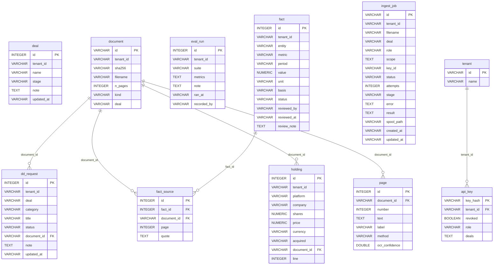
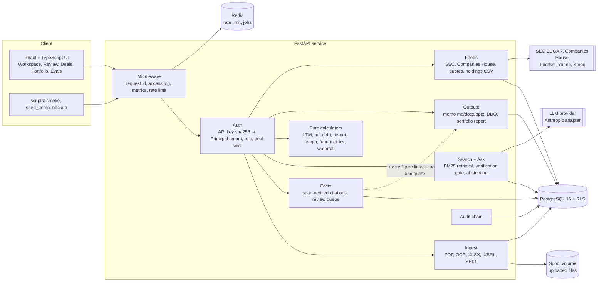
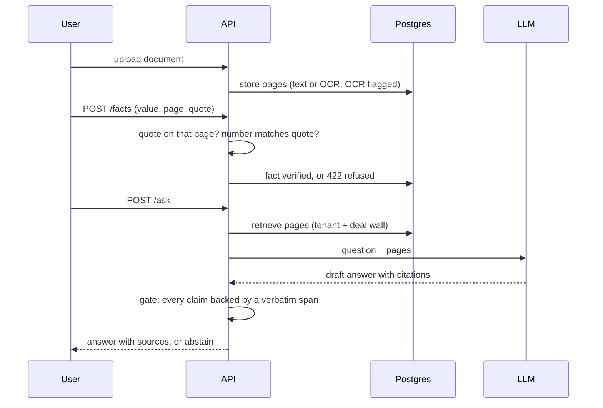
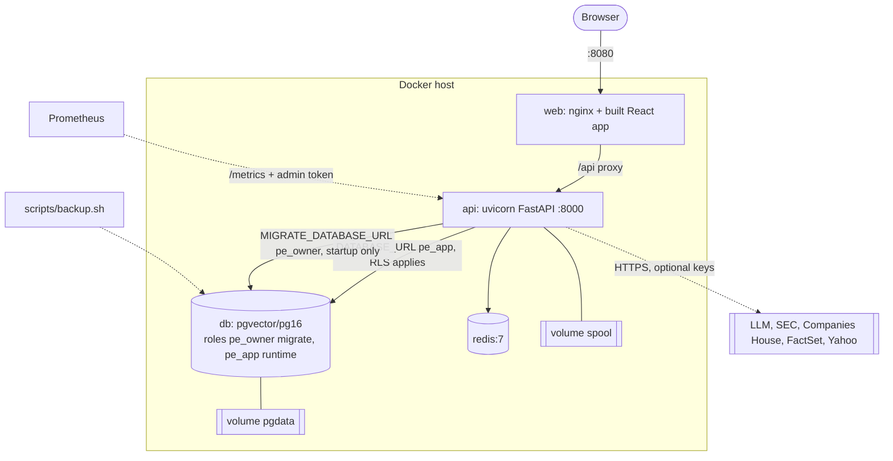
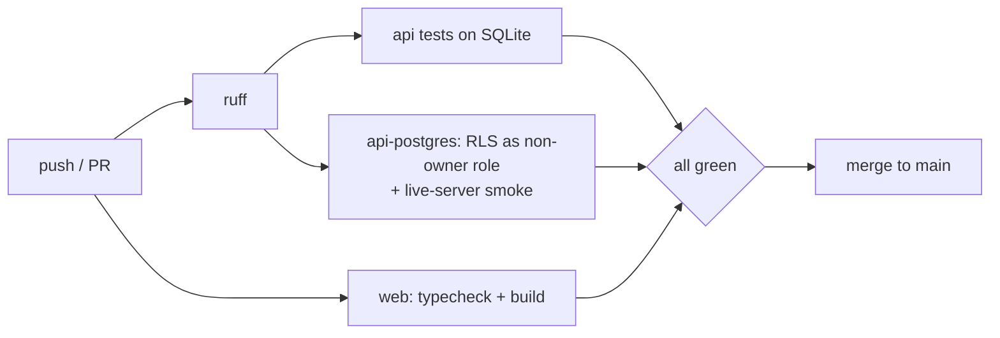

# System diagrams

Mermaid, rendered by GitHub. The database diagram is generated from the models (`scripts/gen_er.py`), so it
cannot drift; the rest are drawn by hand from `docker-compose.yml`, `.github/workflows/ci.yml` and `apps/api/app`.

## 1. Database (generated)

Foreign keys drawn here are the ones declared in the schema. Every tenant-owned table also carries a
`tenant_id` column that is not a declared key: isolation is enforced by Postgres row-level security
(`FORCE RLS`, `app.tenant_id` set per transaction), not by joins. Tables on that list are in `app/rls.py`.

<!-- er:start -->

<!-- er:end -->

## 2. Architecture (components)

## 3. Trust path: document to cited answer

## 4. Deployment (docker compose)

## 5. CI and release

